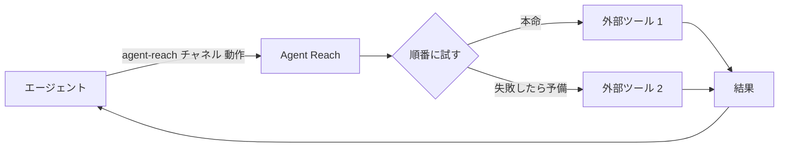

<h1 align="center">👁️ Agent Reach</h1>

<p align="center">
  <strong>AI エージェントが自力では届かないインターネットに、手が届くようにする</strong>
</p>

<p align="center">
  ログインが必要なサイト、動画の中身、中国語のプラットフォーム、整理済みのデータ。どれもコマンド 1 つで取れる
</p>

<p align="center">
  <a href="https://trendshift.io/repositories/24387"></a>
  <a href="https://star-history.com/#Panniantong/Agent-Reach&Date"></a>
</p>

<p align="center">
  <a href="LICENSE"></a>
  <a href="https://www.python.org/"></a>
  <a href="https://github.com/Panniantong/agent-reach/stargazers"></a>
</p>

<p align="center">
  <a href="#クイックスタート">クイックスタート</a> · <a href="docs/README_zh.md">中文</a> · <a href="docs/README_en.md">English</a>
</p>

<p align="center">
  <a href="https://discord.gg/NSZz22R39"></a>
</p>

<p align="center">
  💬 質問、追加してほしいプラットフォーム、ほかの人の使い方が気になる、などは <a href="https://discord.gg/NSZz22R39">Discord</a> でどうぞ。
</p>

> このリポジトリは [Panniantong/Agent-Reach](https://github.com/Panniantong/Agent-Reach) のフォークで、英語・日本語化したもの。Skill（AI 向けの説明）とインストール時の報告が日本語・英語で出る。言語は環境変数 `AGENT_REACH_LANG`（`ja` / `en` / `zh`）で選べ、未設定なら OS の言語設定（`LANG` など）から決まり、どれにも当たらなければ英語になる。

---

## ❤️ スポンサー

> [ここに載りたい方はこちら](mailto:pnt01@foxmail.com)

<details>
<summary>クリックで開く</summary>

<table>
<tr>
<td width="180" align="center"><a href="https://get.brightdata.com/bdenai"></a></td>
<td><a href="https://get.brightdata.com/bdenai">Bright Data</a> | 世界をリードするデータ収集インフラ。Scraper Studio は、やりたいことを普通の言葉で書くだけでスクレイパーを作れて、コードは要らない。Web Unlocker はボット対策を自動で回避し、Amazon、Google、LinkedIn、TikTok のような難しいサイトからもデータを集めやすくする。EC、SNS、検索、地図など幅広いデータ源をカバーする 350 以上の既製 API がそのまま使える。世界中の 1.5 億以上の実在する住宅用 IP で、収集を安定させる。毎月 5,000 リクエストまで無料。<a href="https://get.brightdata.com/bdenai">無料で登録する</a>。</td>
</tr>
<tr>
<td width="180" align="center"><a href="https://www.rapidproxy.io/?ref=pann"></a></td>
<td><a href="https://www.rapidproxy.io/?ref=pann">RapidProxy</a> は開発者向けのデータ収集用プロキシで、安定した住宅用プロキシを提供している。世界 200 以上の国と地域にまたがる 9,000 万以上の住宅用 IP を持ち、自動ローテーションと細かい地域指定に対応。Web スクレイピング、AI 向けのデータ収集と学習、SEO の監視、EC のデータ分析などに使え、収集の効率と安定性を上げられる。Playwright、Selenium、Puppeteer など主要な自動化ツールに対応。購入した通信量は期限切れにならず、価格は $0.55/GB から。<a href="https://www.rapidproxy.io/?ref=pann">無料で試せる</a>。</td>
</tr>
<tr>
<td width="180" align="center"><a href="https://www.browseract.ai/Agent"></a></td>
<td><a href="https://www.browseract.ai/Agent">BrowserAct</a> は、Amazon、LinkedIn、X、Google マップのような複雑なサイトから、必要なデータを何でも取り出せる。取りたいものを普通の言葉で伝えると、エージェントが実際のブラウザでページの流れを探って試し、何度でも使えるデータ収集用のボットを作って、整理した結果を返す。スクレイパーを自分で組む必要も、コードを書く必要もない。ステルスブラウジング、CAPTCHA への対応、高品質な住宅用プロキシを内蔵していて、複雑なサイトからのデータ収集を安定させる。新規登録で 1,000 クレジットがもらえる。<a href="https://www.browseract.ai/Agent">今すぐ無料で試す</a>。</td>
</tr>
<tr>
<td width="180" align="center"><a href="https://www.tencentcloud.com/act/pro/intl-openclaw?referral_code=G76Y819A&amp;lang=zh&amp;pg="></a></td>
<td>Tencent Cloud Lighthouse に OpenClaw を数秒でデプロイでき、会話だけでスムーズに Agent Reach をつなげられる。OpenClaw にワンクリックでインターネットの機能を追加できる。</td>
</tr>
<tr>
<td width="180" align="center"><a href="https://www.coreclaw.com/?utm_source=github&amp;utm_medium=referral&amp;utm_campaign=Reach&amp;utm_term=Reach&amp;utm_id=Reach"></a></td>
<td><a href="https://www.coreclaw.com/?utm_source=github&amp;utm_medium=referral&amp;utm_campaign=Reach&amp;utm_term=Reach&amp;utm_id=Reach">CoreClaw</a> | Web スクレイピングのプラットフォームと既製のデータ収集ツール。Amazon、TikTok、Google マップ、Instagram、Facebook、YouTube などに対応した 100 以上のツールがあり、コード不要で JSON / CSV に書き出せる。料金は成功した結果の分だけ。<a href="https://www.coreclaw.com/?utm_source=github&amp;utm_medium=referral&amp;utm_campaign=Reach&amp;utm_term=Reach&amp;utm_id=Reach">$3 分を無料で試せる！</a></td>
</tr>
<tr>
<td width="180" align="center"><a href="https://www.ucloud.cn/site/active/astraflow?ytag=geo_waituo_Agent"></a></td>
<td><a href="https://www.ucloud.cn/site/active/astraflow?ytag=geo_waituo_Agent">UCloud の AstraFlow（星図）大規模モデル</a>。200 以上のモデルをワンクリックで呼び出せる。Kimi K3、DeepSeek V4/V3、Qwen 3、GLM5.2、happyhorse など世界の主要なオープンソースモデルを内蔵していて、自分で学習させなくてもすぐ使える。</td>
</tr>
</table>

</details>

---

## なぜ Agent Reach が要るのか

**Agent Reach は、エージェントを本当の意味でインターネットにつなぎ、自力では届かないプラットフォームや機能を使えるようにする。**

Claude Code、Codex、Hermes Agent、OpenClaw のような CLI 型のエージェントには、検索と Web ページの読み込みが最初から付いている。それでも、次のものにはほとんど届かない。

- **ログインしないと使えない機能**：小紅書（RED）でノートを検索する、X でアカウントの投稿を見る、求人の詳細を読む、など。
- **動画の中身**：Bilibili と YouTube の字幕、それに YouTube の動画や小宇宙（ポッドキャストのアプリ）の音声の文字起こし。
- **中国語のプラットフォーム**：Bilibili、小紅書、V2EX、雪球（Xueqiu）。普通の検索ではほとんど引っかからない。
- **整理済みのデータ**：雪球の株価、V2EX の投稿と返信、GitHub のリポジトリと issue。整った形で取れる。

Agent Reach は、こうしたプラットフォームの裏で使うツールを代わりに入れて、動くか確かめておく。エージェントはコマンド 1 つで使える。

```bash
agent-reach channels                          # どんなチャネルがあり、それぞれ何ができるか
agent-reach bilibili search "大模型"           # agent-reach <チャネル> <動作> [引数]
agent-reach read https://www.v2ex.com/t/123   # リンクからチャネルを自動で選ぶ
```

### ✅ 使う前に気になりそうなこと

- **どのエージェントで使える？** どのエージェントでも使える。
- **自分のブラウザやアカウントに手を出す？** ログインが必要なサイトでは、Agent Reach 専用のブラウザを使う。裏で動いていて、ウィンドウは開かない。あるサイトを初めて使うとき、Chrome に残っているそのサイトのログイン情報を 1 つだけ専用ブラウザにコピーする。元のブラウザはそのままで、保存済みのパスワードは読まない。コピーされるのはたいていメインのアカウントなので、サブアカウントに切り替えるのがおすすめ。やり方は下の「安全性」を参照。詳しくは[セッションの設定](agent_reach/skill/references/sessions.md)を参照。

---

## 対応しているプラットフォーム

下の表は現在のバージョンでの状況。

| チャネル | 区分 | できること | 必要なもの |
|---|---|---|---|
| bilibili | 標準 | 検索、動画の情報、人気動画、字幕 | なし。字幕はログインが必要（QR コードを読み取る） |
| v2ex | 標準 | 人気の話題、ノード（カテゴリ）、投稿と返信、ユーザー | なし |
| github | 標準 | リポジトリの検索、リポジトリと README の読み込み、issue と PR の読み込み（コメント込み） | なし |
| youtube | 標準 | 動画の情報、検索、字幕、音声の文字起こし | なし。文字起こしは Groq か OpenAI のキーが必要 |
| web | 標準 | Web 検索、Web ページの読み込み（最後の手段） | なし |
| xiaohongshu | 追加 | ノートの検索、本文の読み込み、コメントの閲覧 | ログイン |
| xueqiu | 追加 | リアルタイムの株価、銘柄の検索、人気の投稿、人気の銘柄 | 株価はログイン不要。人気の投稿と銘柄はログインが必要 |
| boss | 追加 | 求人と職務内容（JD）の検索 | ログイン |
| xiaoyuzhou | 追加 | ポッドキャストの文字起こし | Groq のキー |
| linkedin | 追加 | 求人の検索、求人の詳細の読み込み | 公開されている求人はログイン不要。サイト内の検索はログインが必要 |
| reddit | 追加 | 投稿の検索、本文の読み込み、コメントの閲覧、サブレディットの閲覧 | ログイン |
| twitter | 試験的 | ツイートの検索、プロフィール、ユーザーのツイート、スレッドの読み込み | ログイン |
| facebook | 試験的 | 検索、プロフィール | ログイン |
| instagram | 試験的 | ユーザーの検索、プロフィール、ユーザーの投稿 | ログイン |

- **標準**：インストールしたらすぐ使える。要らなければ外せて、外したものは今後のアップデートで勝手に戻らない。
- **追加**：「XX を追加して」と頼めば有効になり、必要なソフトも自動で入る。
- **試験的**：使えるが、プラットフォーム側の自動アクセス対策が厳しく、いつ使えなくなってもおかしくない。

---

## クイックスタート

このフォーク版は、次の 2 つのコマンドを順に実行して入れる。

```bash
uv tool install --force git+https://github.com/hipppppo7/Agent-Reach
agent-reach setup
```

自分で実行してもいいし、エージェントにこう伝えて任せてもいい。

```
Agent Reach をインストールして。`uv tool install --force git+https://github.com/hipppppo7/Agent-Reach` を実行してから `agent-reach setup` を実行して
```

アップデートは `agent-reach update` で行う。これは本家ではなく、このフォークのリリースを見て更新するので、アップデートしても日本語・英語の訳が上書きされることはない。

あとはエージェントが最後までやってくれる。途中で次のことを聞かれるかもしれない。

- **コマンドの実行を許可する**：エージェントが「コマンドを実行できない」と言ったら、そのエージェントの設定で「コマンドの実行を許可」をオンにする。
- **uv を入れる**：uv はコマンドラインのプログラムを入れるための小さなツールで、管理者のパスワードは要らない。パソコンに入っていなければ、エージェントが先に入れる。そのときはひとこと声をかけてくる。
- **追加のチャネルを入れるか**：インストールが終わると、エージェントがすでに使えるもの（Bilibili、V2EX、GitHub、YouTube、Web）と、あとから追加できるものを教えてくれる。選んでから追加すればいいし、あとでいつでも「小紅書を追加して」と言えば、コマンド 1 つで入る。

ログインについて：一部のプラットフォームでは、パソコンにすでにあるログイン情報をそのまま使う。特定のアカウント（たとえばサブアカウント）に切り替えたいときは、エージェントにそう伝えればいい。エージェントが代わりにログインすることはなく、パスワードを聞いてくることもない。

> ⚠️ 本家の注意書きはこのフォークでも同じ。PyPI にある `agent-reach` というパッケージは本プロジェクトではないので、PyPI からは入れず、上の GitHub の URL を使うこと。

---

## インストールしたあとの管理

Agent Reach が入れるもの（各チャネルのツール、ログイン情報、設定）は、すべてパソコンの 1 つのフォルダ（`~/.agent-reach/`）にまとまっていて、ほかの場所には散らばらない。だから、アップデートも管理も削除も簡単で、ひとこと頼めば済む。

エージェントには普段の言葉でそのまま頼めばいい。

| こう言うと | エージェントがやること |
|---|---|
| 「Agent Reach の状態を見て」 | 各チャネルがいま使えるかどうか、前回は動いていたのに今は壊れているのはどれかを教える |
| 「小紅書を追加して」／「小紅書を外して」 | 有効にして必要なものを全部入れる／無効にして、そのログイン情報と専用のツールを消す |
| 「小紅書のログインが切れた」／「アカウントを切り替えたい」／「ログアウトして」 | ログイン用のウィンドウを開いて、本人がログインする／そのサイトのログイン情報を消す |
| 「Agent Reach をアップデートして」 | プログラムと各チャネルのツールをまとめて更新し、ほかにやることがあれば教える |
| 「Agent Reach をアンインストールして」 | 先に消すものを一覧で見せて、確認してから消す |
| 「別の AI でも使えるようにして」 | その AI にも使い方の説明を 1 部置く |

何か問題が起きたら、エージェントがどのプラットフォームで、何が原因で、次にどうすればいいかを教えてくれる。よくある問題は [troubleshooting.md](docs/troubleshooting.md) を参照。

---

## 設計の考え方

### 🔌 プラットフォームごとに「本命 + 予備」の順番付きツール一覧を持つ

各プラットフォームの動作ごとに、順番に試すツールの一覧がある。たとえば Bilibili の動画を読むときは、まず bili-cli を使い、失敗したら自動で Bilibili の公開 API に切り替える。Web ページを読むときは、まず Jina Reader、だめなら Exa を使う。



プラットフォームの仕様変更やツールが動かなくなるのはよくあること。ツールを入れ替えるときは、この一覧を直すだけで、エージェント側の使い方は変わらない。

---

## 安全性

- **読むだけ**：検索と読み込みしかしない。投稿、コメント、いいね、DM はしない。
- **代わりにログインすることはなく、パスワードも聞かない。** 一部のプラットフォームでは、パソコンにすでにあるログイン情報を使う（コピーするのはそのサイトの分だけで、元のブラウザはそのまま）。どうしてもログインし直す必要があるときだけ専用のウィンドウを開き、本人がログインする。
- **専用ブラウザはこのパソコンからしかつながらない**。ほかのパソコンからは接続できない。
- **サブアカウントでのログインがおすすめ。** 使い回されるのはたいていメインのアカウントで、プラットフォームは自動アクセスに使われたアカウントを制限することがある。サブアカウントに切り替えたいときは、エージェントにそう伝えればいい。
- **キーはチャットに貼らない**：自分のターミナルで `agent-reach configure groq-key` を実行して入力する。

### 🗑️ アンインストール

エージェントに「Agent Reach をアンインストールして」と伝える。先に消すものを一覧で見せて、確認してから消す。消すのは Agent Reach が自分で入れたものだけで、ほかのファイルやブラウザには手を付けない。最後に、プログラム本体の消し方を教えてくれる。

---

## ⭐ Star する理由

このプロジェクトは私（本家の作者）が毎日自分で使っているので、これからもメンテナンスを続ける。

- 新しい要望や、追加してほしいチャネルが出てきたら、順次追加していく
- どのチャネルも**ちゃんと動く、使いやすい、無料**であるようにできるだけ努める
- プラットフォームが自動アクセス対策や API を変えたら、なんとか対応する

次に必要になったとき見つけられるように、Star しておいてほしい。⭐

---

## 謝辞

[OpenCLI](https://github.com/jackwener/opencli) · [bili-cli](https://github.com/public-clis/bilibili-cli) · [boss-agent-cli](https://github.com/can4hou6joeng4/boss-agent-cli) · [yt-dlp](https://github.com/yt-dlp/yt-dlp) · [Jina Reader](https://github.com/jina-ai/reader) · [Exa](https://exa.ai)

## 連絡先

- 📧 **Email:** pnt01@foxmail.com
- 🐦 **Twitter/X:** [@Neo_Reidlab](https://x.com/Neo_Reidlab)

## ビジネスの相談 / 交流グループ

協業の相談や、交流グループに入りたい場合は、WeChat で私を追加するか、Discord のコミュニティに直接参加してほしい。

<p align="center">
  
  &nbsp;&nbsp;
  <a href="https://discord.gg/NSZz22R39"></a>
</p>

> バグの報告や機能の要望は、追跡しやすいので [GitHub Issues](https://github.com/Panniantong/Agent-Reach/issues) へ。

## 詐欺への注意

Agent Reach には、公式のトークン、コイン、投資商品、手数料の受け取りキャンペーン、ウォレット接続はなく、Solana / Pump.fun のプロジェクトもない。Agent Reach の名前、GitHub のアドレス、作者の身元を使った暗号資産のプロジェクトは、どれもこのリポジトリとは無関係。それを理由にウォレットをつないだり、何かの手数料を受け取ろうとしたりしないこと。

## License

[MIT](LICENSE)

## 関連リンク

[Agent Skills Hub](https://agentskillshub.top/) — Claude のスキルや MCP サーバーを、安全かどうか迷わずに探せる。133,000 件以上の全項目に安全性の格付けと品質のスコアが付いていて、8 時間ごとに更新される。

[AtomGit ミラー](https://atomgit.com/qq_51337814/Agent-Reach) — Agent Reach を AtomGit に同期したミラー。中国国内からアクセスやクローンをしやすくするためのもの。

## Star History

<a href="https://www.star-history.com/?type=date&repos=Panniantong%2FAgent-Reach"><picture><source media="(prefers-color-scheme: dark)" srcset="https://api.star-history.com/chart?repos=Panniantong/Agent-Reach&type=date&theme=dark&legend=top-left&sealed_token=K3_u-LJQTVURYu-38Tqa_VWJOSqMf_HbAw-QKSdGwEq6seqznugdIpXdSeztEdOutT40IBXwVxTmg8wS_OSygb5UWf1x8e-Fai6aygrjq6QH8vU09EcqQCN7atp-76HmxX-j9fnZ9NiSrLDNzK98TnXBFJ_Wb_y80I0nWr3O8DdGnLXFhAJgoNK3Jz8D" /><source media="(prefers-color-scheme: light)" srcset="https://api.star-history.com/chart?repos=Panniantong/Agent-Reach&type=date&legend=top-left&sealed_token=P2746KOq7grpS8Q-nrqEzci1-Z0-dOw-M3KEqju-l3TyF24NMyRDR7TnxdReJWlXyomoT4mjjqC28-2-c2G6CnzmS1hgYdEDiGPmLkmEqKP5tgjORXshdrUFxoSxTqmIKEMFFmGZUX1v3ec-q_XMyftTVWzluiQH7CvKoZ1uDKU3PJN05mO22u7qlLeG" /></picture></a>
